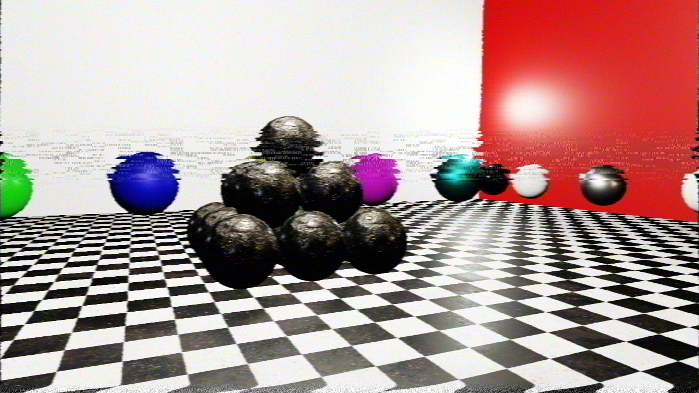

# VHS Tape Effect

**Code Name:** VhsTapeEffect

## Description

In this example, the playback of a VHS tape has been simulated on top of the tone mapped scene using a separate post-processing pass. The image is converted to the YIQ color space of the NTSC signal, and luma and chroma are filtered with different horizontal bandwidths, so colors are blurred, delayed and bleed over the edges. Finally luma noise, chroma noise and dropouts are added.

## Output

## Controls

| Input   | Action                          |
|---------|---------------------------------|
| W/A/S/D | Move the camera                 |
| Mouse   | Look around with the camera     |
| Esc     | Close the window                |
| Space   | Turn on/off VHS effect          |
| Q       | Increase exposure value         |
| E       | Decrease exposure value         |
| R       | Increase tracking error         |
| F       | Decrease tracking error         |
| T       | Increase tape noise (tape wear) |
| G       | Decrease tape noise (tape wear) |

## Application Parameters

### Settings

| Parameter / Key                | Type              | Usage in Code                   | Description                         | Default Value |
|--------------------------------|-------------------|---------------------------------|-------------------------------------|---------------|
| AppSettings.ClearColor         | VkClearColorValue | AppSettings::ClearColor         | Background color of the screen      |               |
| AppSettings.MouseSensitivity   | float             | AppSettings::MouseSensitivity   | Mouse sensitivity value             |               |
| AppSettings.CameraSpeed        | float             | AppSettings::CameraSpeed        | Speed of the camera                 |               |
| AppSettings.FilmGrainFrameRate | float             | AppSettings::FilmGrainFrameRate | Frame rate of the film grain effect |               |

## Learning Objectives

- Understanding how to simulate the limited luma and chroma bandwidth of a VHS tape in the YIQ color space
- Implementing time dependent line displacements (wobble, jitter, tracking error, head switching)
- Generating tape noise and dropouts procedurally with has functions

## Shader Status

| Shader Type | Status             | Notes                |
|-------------|--------------------|----------------------|
| GLSL        | :white_check_mark: |                      |
| HLSL        | :x:                | Will be implemented. |
| Slang       | :x:                | Will be implemented. |

## Theoretical Background

None

## Extensions Used

### Instance

Window system-dependent extensions:
- VK_KHR_surface
- VK_KHR_win32_surface (Windows)

### Device

- VK_KHR_swapchain
