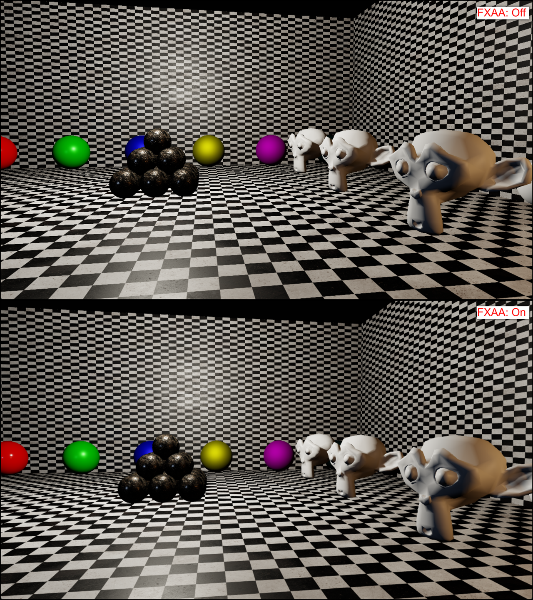

# Fast Approximate Anti-Aliasing (FXAA)

**Code Name:** FastApproximateAntiAliasing

## Description

In this example, Fast Approximate Anti-Aliasing (FXAA 3.11 quality version) has been implemented as a post-processing pass on the tone mapped image with selectable quality presets.

## Output

## Controls

| Input   | Action                                     |
|---------|--------------------------------------------|
| W/A/S/D | Move the camera                            |
| Mouse   | Look around with the camera                |
| Esc     | Close the window                           |
| Space   | Turn on/off FXAA                           |
| 1       | Low quality preset                         |
| 2       | Medium quality preset                      |
| 3       | High quality preset                        |
| 4       | Extreme quality preset                     |
| Q       | Increase exposure value                    |
| E       | Decrease exposure value                    |

## Application Parameters

### Settings

| Parameter / Key                | Type              | Usage in Code                   | Description                         | Default Value |
|--------------------------------|-------------------|---------------------------------|-------------------------------------|---------------|
| AppSettings.ClearColor         | VkClearColorValue | AppSettings::ClearColor         | Background color of the screen      |               |
| AppSettings.MouseSensitivity   | float             | AppSettings::MouseSensitivity   | Mouse sensitivity value             |               |
| AppSettings.CameraSpeed        | float             | AppSettings::CameraSpeed        | Speed of the camera                 |               |

## Learning Objectives

- Detecting the edges with the local luma contrast and finding the edge direction
- Following the edges to their ends and computing the sub-pixel blend offset
- Comparing the quality presets for FXAA (search steps and edge threshold)

## Shader Status

| Shader Type | Status             | Notes                |
|-------------|--------------------|----------------------|
| GLSL        | :white_check_mark: |                      |
| HLSL        | :x:                | Will be implemented. |
| Slang       | :x:                | Will be implemented. |

## Theoretical Background

None

## Extensions Used

### Instance

Window system-dependent extensions:
- VK_KHR_surface
- VK_KHR_win32_surface (Windows)

### Device

- VK_KHR_swapchain
