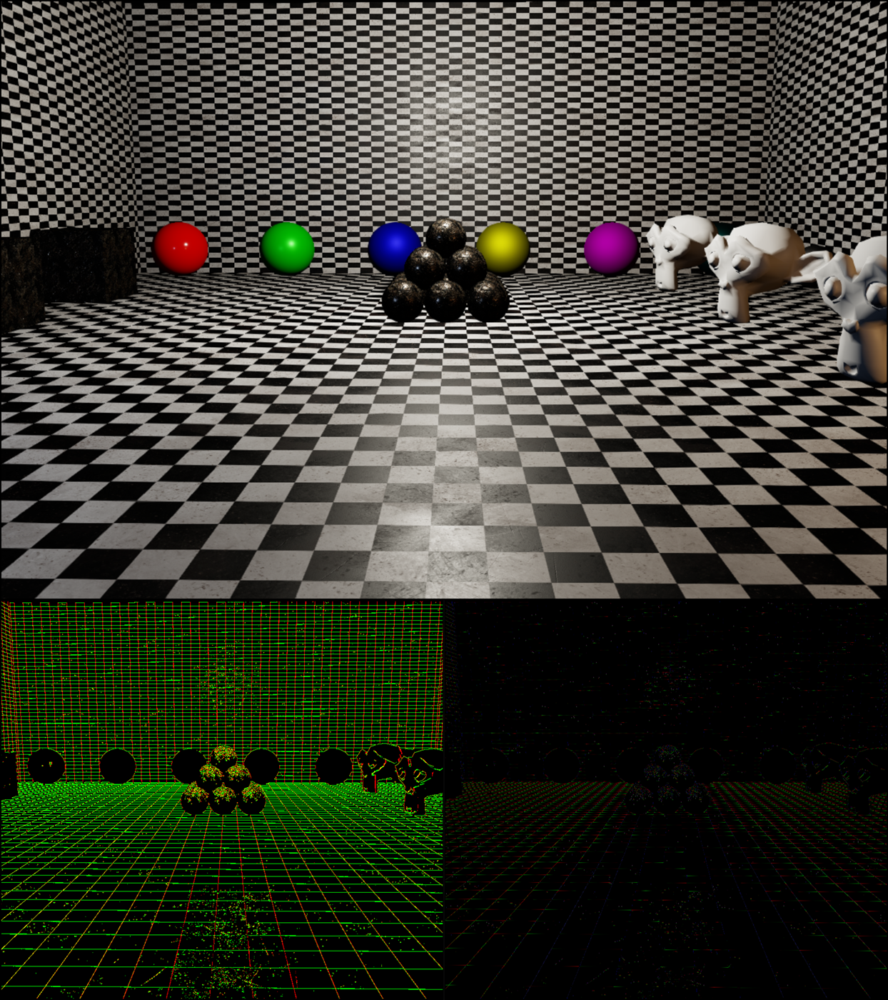

# Subpixel Morphological Anti-Aliasing (SMAA 1x)

**Code Name:** SubpixelMorphologicalAntiAliasing

## Description

In this example, Subpixel Morphological Anti-Aliasing (SMAA 1x) has been implemented with its three passes: Luma edge detection, blending weight calculation (with the precomputed area and search textures) and neighborhood blending.

## Output

## Controls

| Input   | Action                                               |
|---------|------------------------------------------------------|
| W/A/S/D | Move the camera                                      |
| Mouse   | Look around with the camera                          |
| Esc     | Close the window                                     |
| Space   | Turn on/off SMAA                                     |
| 1       | Low quality preset                                   |
| 2       | Medium quality preset                                |
| 3       | High quality preset                                  |
| 4       | Ultra quality preset                                 |
| V       | Switch view (final image / edges / blending weights) |
| Q       | Increase exposure value                              |
| E       | Decrease exposure value                              |

## Application Parameters

### Settings

| Parameter / Key                | Type              | Usage in Code                   | Description                         | Default Value |
|--------------------------------|-------------------|---------------------------------|-------------------------------------|---------------|
| AppSettings.ClearColor         | VkClearColorValue | AppSettings::ClearColor         | Background color of the screen      |               |
| AppSettings.MouseSensitivity   | float             | AppSettings::MouseSensitivity   | Mouse sensitivity value             |               |
| AppSettings.CameraSpeed        | float             | AppSettings::CameraSpeed        | Speed of the camera                 |               |

## Learning Objectives

- Understanding the 3 passes of the SMAA (edge detection, blending weight calculation, neighborhood blending)
- Detecting the edges with the luma differences and the local contrast adaptation
- Searching the lines with bilinear fetches and decoding their ends with the search texture
- Using the precomputed area texture to find the blending weights of the line patterns
- Handling diagonal lines and sharp corners

## Shader Status

| Shader Type | Status             | Notes                |
|-------------|--------------------|----------------------|
| GLSL        | :white_check_mark: |                      |
| HLSL        | :x:                | Will be implemented. |
| Slang       | :x:                | Will be implemented. |

## Theoretical Background

None

## Extensions Used

### Instance

Window system-dependent extensions:
- VK_KHR_surface
- VK_KHR_win32_surface (Windows)

### Device

- VK_KHR_swapchain
