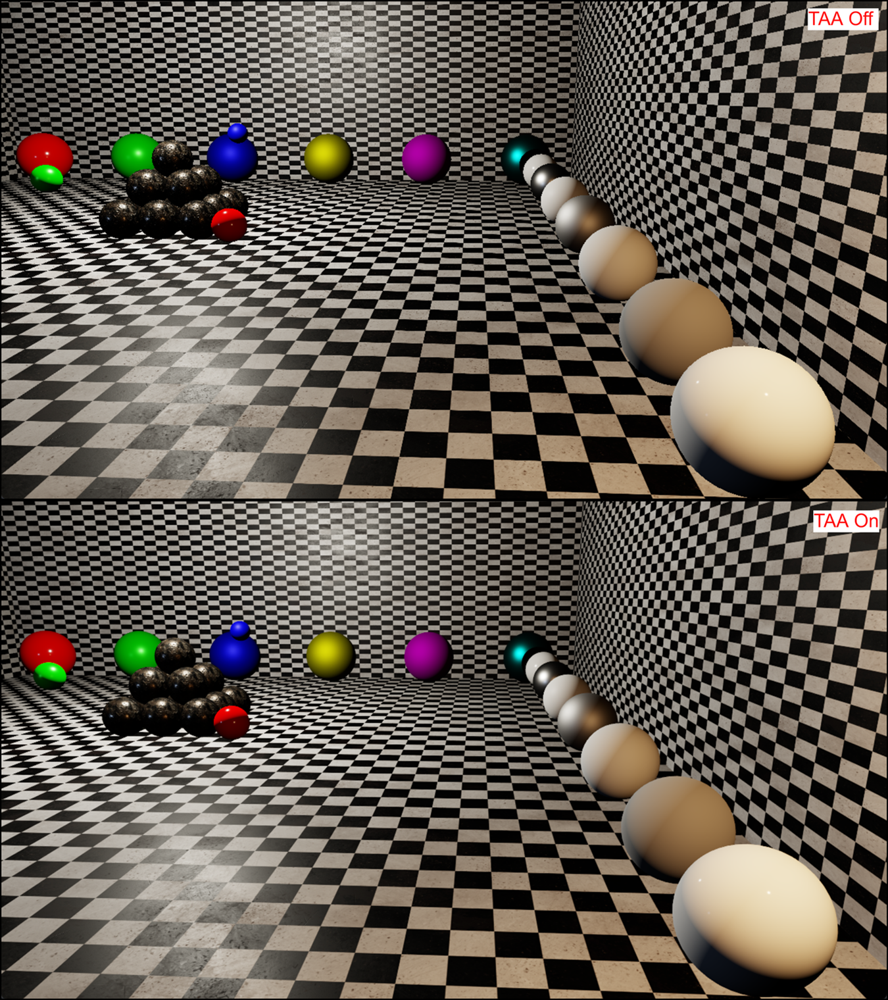

# Temporal Anti-Aliasing (TAA)

**Code Name:** TemporalAntiAliasing

## Description

In this example, Temporal Anti-Aliasing (TAA) has been implemented: Sub-pixel jitter of the projection (Halton sequence), history reprojection with the velocity buffer (closest depth in the neighborhood, Catmull-Rom history filter), neighborhood clipping against ghosting and exponential history blending.

## Output

## Controls

| Input   | Action                                                     |
|---------|------------------------------------------------------------|
| W/A/S/D | Move the camera                                            |
| Mouse   | Look around with the camera                                |
| Esc     | Close the window                                           |
| Space   | Turn on/off TAA                                            |
| P       | Pause/resume the moving objects                            |
| Q       | Increase exposure value                                    |
| E       | Decrease exposure value                                    |
| R       | Increase the weight of the current frame (less ghosting)   |
| F       | Decrease the weight of the current frame (smoother result) |

## Application Parameters

### Settings

| Parameter / Key                | Type              | Usage in Code                   | Description                         | Default Value |
|--------------------------------|-------------------|---------------------------------|-------------------------------------|---------------|
| AppSettings.ClearColor         | VkClearColorValue | AppSettings::ClearColor         | Background color of the screen      |               |
| AppSettings.MouseSensitivity   | float             | AppSettings::MouseSensitivity   | Mouse sensitivity value             |               |
| AppSettings.CameraSpeed        | float             | AppSettings::CameraSpeed        | Speed of the camera                 |               |

## Learning Objectives

- Jittering the projection with a sub-pixel offset from the Halton sequence
- Using the velocity of the closest pixel in the neighborhood for sharp moving edges
- Sampling the history with a Catmull-Rom filter to reduce the blur
- Removing the ghosting with the neighborhood clamp and understanding its limitations

## Shader Status

| Shader Type | Status             | Notes                |
|-------------|--------------------|----------------------|
| GLSL        | :white_check_mark: |                      |
| HLSL        | :x:                | Will be implemented. |
| Slang       | :x:                | Will be implemented. |

## Theoretical Background

None

## Extensions Used

### Instance

Window system-dependent extensions:
- VK_KHR_surface
- VK_KHR_win32_surface (Windows)

### Device

- VK_KHR_swapchain
