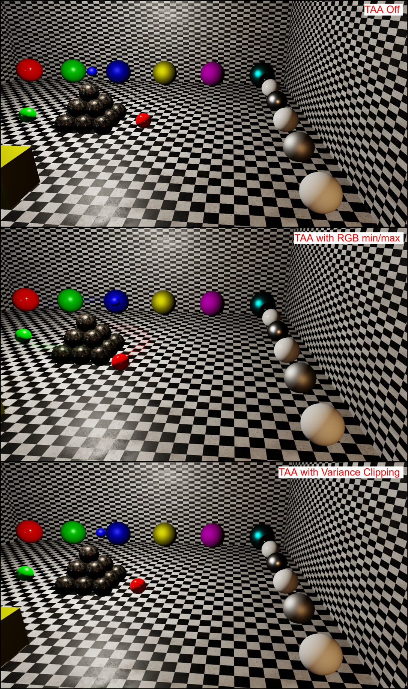

# Improved TAA with Variance Clipping

**Code Name:** TemporalAntiAliasingVariance

## Description

In this example, the Temporal Anti-Aliasing (TAA) has been improved with variance clipping: The history is clipped to the variance box (mean and standard deviation) of the neighborhood in the YCoCg color space, which removes the ghosting much better than the RGB min/max clamp.

## Output

## Controls

| Input   | Action                                                                 |
|---------|------------------------------------------------------------------------|
| W/A/S/D | Move the camera                                                        |
| Mouse   | Look around with the camera                                            |
| Esc     | Close the window                                                       |
| Space   | Turn on/off TAA                                                        |
| P       | Pause/resume the moving objects                                        |
| C       | Switch history rejection (RGB min-max clamp / YCoCg variance clipping) |
| Q       | Increase exposure value                                                |
| E       | Decrease exposure value                                                |
| R       | Increase the weight of the current frame (less ghosting)               |
| F       | Decrease the weight of the current frame (smoother result)             |

## Application Parameters

### Settings

| Parameter / Key                | Type              | Usage in Code                   | Description                         | Default Value |
|--------------------------------|-------------------|---------------------------------|-------------------------------------|---------------|
| AppSettings.ClearColor         | VkClearColorValue | AppSettings::ClearColor         | Background color of the screen      |               |
| AppSettings.MouseSensitivity   | float             | AppSettings::MouseSensitivity   | Mouse sensitivity value             |               |
| AppSettings.CameraSpeed        | float             | AppSettings::CameraSpeed        | Speed of the camera                 |               |

## Learning Objectives

- Understanding why the RGB min/max clamp leaves colored ghost trails along high contrast edges
- Building the neighborhood box in the YCoCg color space (separated luma and chroma)
- Calculation the variance box from the mean and the standard deviation of the neighborhood
- Clipping the history towards the box center instead of the per-channel clamp

## Shader Status

| Shader Type | Status             | Notes                |
|-------------|--------------------|----------------------|
| GLSL        | :white_check_mark: |                      |
| HLSL        | :x:                | Will be implemented. |
| Slang       | :x:                | Will be implemented. |

## Theoretical Background

None

## Extensions Used

### Instance

Window system-dependent extensions:
- VK_KHR_surface
- VK_KHR_win32_surface (Windows)

### Device

- VK_KHR_swapchain
