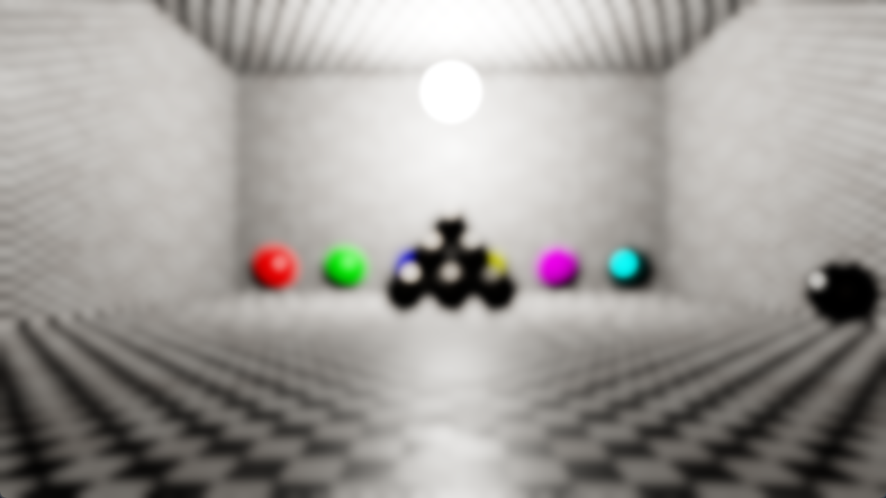

# Blur Techniques Comparison (Box, Gaussian, Kawase, Dual Kawase)

**Code Name:** BlurTechniquesComparison

## Description

In this example, 4 common image blur techniques have been implemented as post-processing passes: Separable box blur, separable gaussian blur (with linear sampling), Kawase blur and Dual Kawase blur.

## Output

## Controls

| Input   | Action                            |
|---------|-----------------------------------|
| W/A/S/D | Move the camera                   |
| Mouse   | Look around with the camera       |
| Esc     | Close the window                  |
| 1       | No blur (original image)          |
| 2       | Separable box blur                |
| 3       | Separable gaussian blur (default) |
| 4       | Kawase blur                       |
| 5       | Dual Kawase blur                  |
| Q       | Increase exposure value           |
| E       | Decrease exposure value           |
| R       | Increase blur level (1-5)         |
| F       | Decrease blur level (1-5)         |

## Application Parameters

### Settings

| Parameter / Key              | Type              | Usage in Code                 | Description                      | Default Value |
|------------------------------|-------------------|-------------------------------|----------------------------------|---------------|
| AppSettings.ClearColor       | VkClearColorValue | AppSettings::ClearColor       | Background color of the screen   |               |
| AppSettings.MouseSensitivity | float             | AppSettings::MouseSensitivity | Mouse sensitivity value          |               |
| AppSettings.CameraSpeed      | float             | AppSettings::CameraSpeed      | Speed of the camera              |               |

## Learning Objectives

- Understanding how separable box and gaussian blurs work and how linear sampling halves the texture fetches
- Understanding how Kawase blur approximates a wide gaussian with a few cheap iterations
- Understanding how Dual Kawase blur uses a downsample/upsample chain to get very wide blurs

## Shader Status

| Shader Type | Status             | Notes                |
|-------------|--------------------|----------------------|
| GLSL        | :white_check_mark: |                      |
| HLSL        | :x:                | Will be implemented. |
| Slang       | :x:                | Will be implemented. |

## Theoretical Background

None

## Extensions Used

### Instance

Window system-dependent extensions:
- VK_KHR_surface
- VK_KHR_win32_surface (Windows)

### Device

- VK_KHR_swapchain
