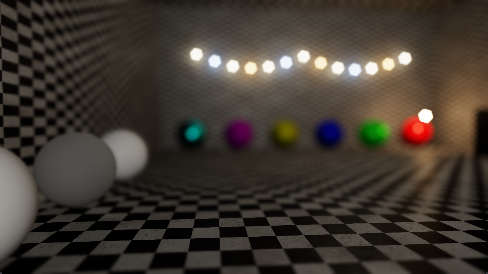

# Bokeh Depth of Field

**Code Name:** BokehDepthOfField

## Description

In this example, bright highlights are scattered as bokeh sprites with the shape of the aperture (regular polygon or circle) on top of a gather-based depth of field in half resolution.

## Output

## Controls

| Input   | Action                                              |
|---------|-----------------------------------------------------|
| W/A/S/D | Move the camera                                     |
| Mouse   | Look around with the camera                         |
| Esc     | Close the window                                    |
| Space   | Turn on/off depth of field effect                   |
| 1       | Switch debug view to final image                    |
| 2       | Switch debug view to CoC                            |
| 3       | Switch debug view to bokeh sprites only             |
| N       | Switch aperture shape (6 / 5 / 8 blades, circle)    |
| Q       | Increase exposure value                             |
| E       | Decrease exposure value                             |
| R       | Increase focus distance                             |
| F       | Decrease focus distance                             |
| T       | Increase f-stop value (smaller aperture, less blur) |
| G       | Decrease f-stop value (larger aperture, more blur)  |

## Application Parameters

### Settings

| Parameter / Key              | Type              | Usage in Code                 | Description                      | Default Value |
|------------------------------|-------------------|-------------------------------|----------------------------------|---------------|
| AppSettings.ClearColor       | VkClearColorValue | AppSettings::ClearColor       | Background color of the screen   |               |
| AppSettings.MouseSensitivity | float             | AppSettings::MouseSensitivity | Mouse sensitivity value          |               |
| AppSettings.CameraSpeed      | float             | AppSettings::CameraSpeed      | Speed of the camera              |               |

## Learning Objectives

- Understanding how bokeh shapes are formed by the aperture of a real lens
- Separating the energy of bright highlights from the gathered image without losing or duplicating energy
- Scattering sprites with an instanced draw call without vertex buffers and culling them in the vertex shader
- Using additive blending to accumulate the sprites and occluding far field sprites with the CoC

## Shader Status

| Shader Type | Status             | Notes                |
|-------------|--------------------|----------------------|
| GLSL        | :white_check_mark: |                      |
| HLSL        | :x:                | Will be implemented. |
| Slang       | :x:                | Will be implemented. |

## Theoretical Background

None

## Extensions Used

### Instance

Window system-dependent extensions:
- VK_KHR_surface
- VK_KHR_win32_surface (Windows)

### Device

- VK_KHR_swapchain
