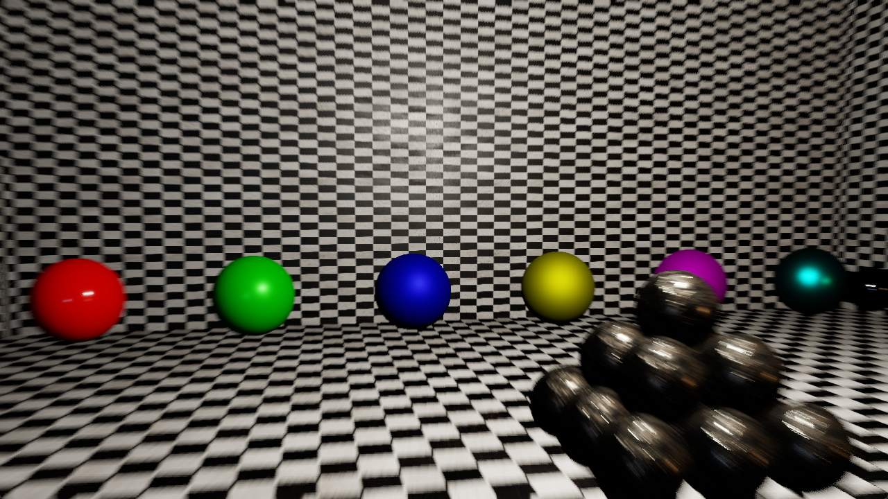

# Camera Motion Blur via Depth Reprojection

**Code Name:** CameraMotionBlur

## Description

In this example, a camera motion blur effect has been implemented with depth reprojection. View-space position o each pixel is reprojected into the previous frame and the HDR color is averaged along the resulting screen-space velocity.

## Output

## Controls

| Input   | Action                                                  |
|---------|---------------------------------------------------------|
| W/A/S/D | Move the camera                                         |
| Mouse   | Look around with the camera                             |
| Esc     | Close the window                                        |
| Space   | Turn on/off motion blur effect                          |
| B       | Switch debug view (final image / velocity)              |
| Q       | Increase exposure value                                 |
| E       | Decrease exposure value                                 |
| R       | Slower shutter speed (longer exposure time, more blur)  |
| F       | Faster shutter speed (shorter exposure time, less blur) |

## Application Parameters

### Settings

| Parameter / Key                | Type              | Usage in Code                   | Description                         | Default Value |
|--------------------------------|-------------------|---------------------------------|-------------------------------------|---------------|
| AppSettings.ClearColor         | VkClearColorValue | AppSettings::ClearColor         | Background color of the screen      |               |
| AppSettings.MouseSensitivity   | float             | AppSettings::MouseSensitivity   | Mouse sensitivity value             |               |
| AppSettings.CameraSpeed        | float             | AppSettings::CameraSpeed        | Speed of the camera                 |               |

## Learning Objectives

- Reconstructing the screen space velocity of the camera motion from the depth (view-space position) and the previous view-projection matrix
- Averaging the color along the velocity and hiding the banding with a per-pixel jitter
- Scaling the blur length with the shutter speed and the frame time

## Shader Status

| Shader Type | Status             | Notes                |
|-------------|--------------------|----------------------|
| GLSL        | :white_check_mark: |                      |
| HLSL        | :x:                | Will be implemented. |
| Slang       | :x:                | Will be implemented. |

## Theoretical Background

None

## Extensions Used

### Instance

Window system-dependent extensions:
- VK_KHR_surface
- VK_KHR_win32_surface (Windows)

### Device

- VK_KHR_swapchain
