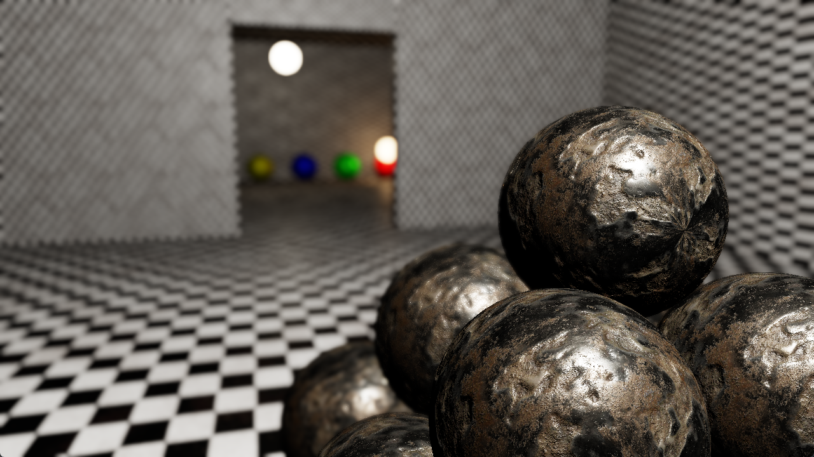

# Depth of Field (Gather-Based, Thin Lens CoC)

**Code Name:** GatherDepthOfField

## Description

In this example, a gather-based depth of field (DoF) effect has been implemented in half-resolution. The signed circle of confusion (CoC) is calculated with the thin lens model (focal length, f-stop and focus distance) from the linear view-space depth (G-Buffer position).

## Output

## Controls

| Input   | Action                                              |
|---------|-----------------------------------------------------|
| W/A/S/D | Move the camera                                     |
| Mouse   | Look around with the camera                         |
| Esc     | Close the window                                    |
| Space   | Turn on/off depth of field effect                   |
| B       | Switch debug view (final image / CoC)               |
| Q       | Increase exposure value                             |
| E       | Decrease exposure value                             |
| R       | Increase focus distance                             |
| F       | Decrease focus distance                             |
| T       | Increase f-stop value (smaller aperture, less blur) |
| G       | Decrease f-stop value (larger aperture, more blur)  |

## Application Parameters

### Settings

| Parameter / Key              | Type              | Usage in Code                 | Description                      | Default Value |
|------------------------------|-------------------|-------------------------------|----------------------------------|---------------|
| AppSettings.ClearColor       | VkClearColorValue | AppSettings::ClearColor       | Background color of the screen   |               |
| AppSettings.MouseSensitivity | float             | AppSettings::MouseSensitivity | Mouse sensitivity value          |               |
| AppSettings.CameraSpeed      | float             | AppSettings::CameraSpeed      | Speed of the camera              |               |

## Learning Objectives

- Calculating the circle of confusion (CoC) with the thin lens model from focal length, f-stop and focus distance
- Separating the near and far fields with a signed CoC and gathering them as different layers
- Using depth-aware weighting to prevent bleeding of the in-focus objects onto the blurred background
- Spreading the near field over the in-focus areas with scatter-as-gatter and calculating its coverage
- Running the expensive gather pass in half resolution and mixing the result with the full-res image

## Shader Status

| Shader Type | Status             | Notes                |
|-------------|--------------------|----------------------|
| GLSL        | :white_check_mark: |                      |
| HLSL        | :x:                | Will be implemented. |
| Slang       | :x:                | Will be implemented. |

## Theoretical Background

None

## Extensions Used

### Instance

Window system-dependent extensions:
- VK_KHR_surface
- VK_KHR_win32_surface (Windows)

### Device

- VK_KHR_swapchain
