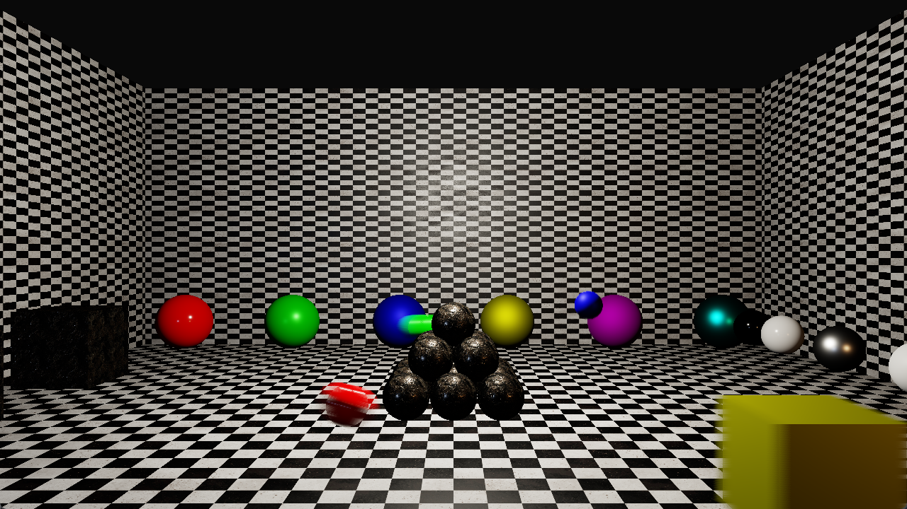

# Per-Object Motion Blur with Velocity Buffer

**Code Name:** PerObjectMotionBlur

## Description

In this example, a per-object motion blur effect has been implemented with a velocity buffer and the reconstruction filter of McGuire et al. (TileMax, NeighborMax and depth-aware gather).

## Output

## Controls

| Input   | Action                                                          |
|---------|-----------------------------------------------------------------|
| W/A/S/D | Move the camera                                                 |
| Mouse   | Look around with the camera                                     |
| Esc     | Close the window                                                |
| Space   | Turn on/off motion blur effect                                  |
| B       | Switch debug view (final image / velocity buffer / NeighborMax) |
| P       | Pause/resume the moving objects                                 |
| Q       | Increase exposure value                                         |
| E       | Decrease exposure value                                         |
| R       | Slower shutter speed (longer exposure time, more blur)          |
| F       | Faster shutter speed (shorter exposure time, less blur)         |

## Application Parameters

### Settings

| Parameter / Key                | Type              | Usage in Code                   | Description                         | Default Value |
|--------------------------------|-------------------|---------------------------------|-------------------------------------|---------------|
| AppSettings.ClearColor         | VkClearColorValue | AppSettings::ClearColor         | Background color of the screen      |               |
| AppSettings.MouseSensitivity   | float             | AppSettings::MouseSensitivity   | Mouse sensitivity value             |               |
| AppSettings.CameraSpeed        | float             | AppSettings::CameraSpeed        | Speed of the camera                 |               |

## Learning Objectives

- Writing a velocity buffer in the geometry pass with the current and the previous frame's matrices
- Understanding the TileMax and NeighborMax passes and why the blur needs the velocities of the neighbor tiles
- Implementing the reconstruction filter (McGuire et al. 2012) with soft depth comparisons, cone and cylinder weights

## Shader Status

| Shader Type | Status             | Notes                |
|-------------|--------------------|----------------------|
| GLSL        | :white_check_mark: |                      |
| HLSL        | :x:                | Will be implemented. |
| Slang       | :x:                | Will be implemented. |

## Theoretical Background

None

## Extensions Used

### Instance

Window system-dependent extensions:
- VK_KHR_surface
- VK_KHR_win32_surface (Windows)

### Device

- VK_KHR_swapchain
