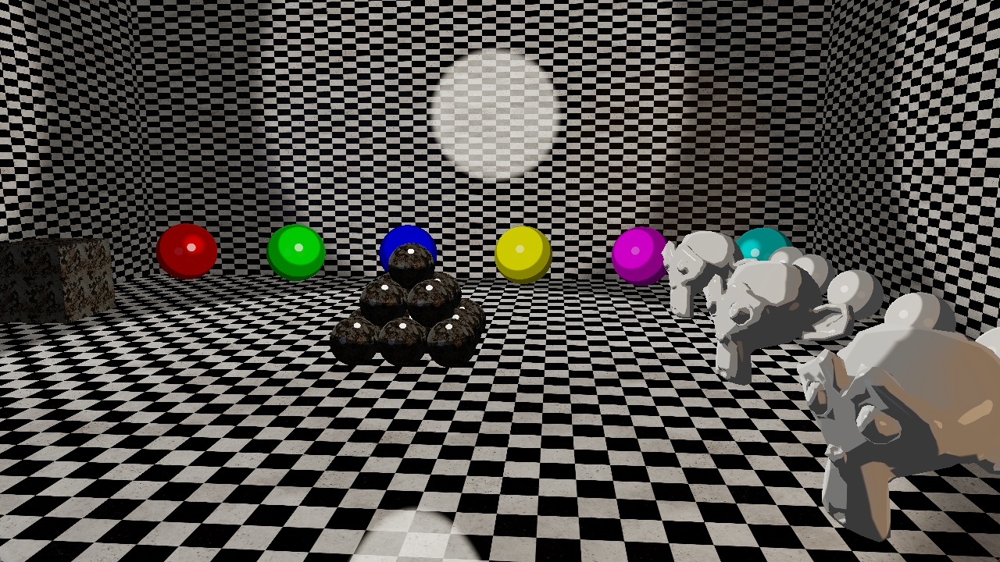

# Cel Shading with Toon Ramp

**Code Name:** CelShading

## Description

In this example, cel shading has been implemented in the light pass with a toon ramp (optimized brightness bands), hard specular highlights and rim light.

**NOTE:** Cel shading is not a post-processing effect by itself; it is a lighting model applied in the light pass of the deferred renderer (or forward renderer). It is included in this category because it is common stylization technique, and it is mostly combined with post-processing effects such as screen-space outlines.

## Output

## Controls

| Input   | Action                                |
|---------|---------------------------------------|
| W/A/S/D | Move the camera                       |
| Mouse   | Look around with the camera           |
| Esc     | Close the window                      |
| Space   | Switch shading (Cel shading / PBR)    |
| Q       | Increase exposure value               |
| E       | Decrease exposure value               |
| R       | Increase toon ramp band count (2 - 6) |
| F       | Decrease toon ramp band count (2 - 6) |

## Application Parameters

### Settings

| Parameter / Key                | Type              | Usage in Code                   | Description                         | Default Value |
|--------------------------------|-------------------|---------------------------------|-------------------------------------|---------------|
| AppSettings.ClearColor         | VkClearColorValue | AppSettings::ClearColor         | Background color of the screen      |               |
| AppSettings.MouseSensitivity   | float             | AppSettings::MouseSensitivity   | Mouse sensitivity value             |               |
| AppSettings.CameraSpeed        | float             | AppSettings::CameraSpeed        | Speed of the camera                 |               |

## Learning Objectives

- Implementing cel shading in a deferred light pass
- Quantizing the brightness of the total diffuse light with a toon ramp while keeping the light color
- Adding hard-edged specular highlights and rim light for the toon look

## Shader Status

| Shader Type | Status             | Notes                |
|-------------|--------------------|----------------------|
| GLSL        | :white_check_mark: |                      |
| HLSL        | :x:                | Will be implemented. |
| Slang       | :x:                | Will be implemented. |

## Theoretical Background

None

## Extensions Used

### Instance

Window system-dependent extensions:
- VK_KHR_surface
- VK_KHR_win32_surface (Windows)

### Device

- VK_KHR_swapchain
