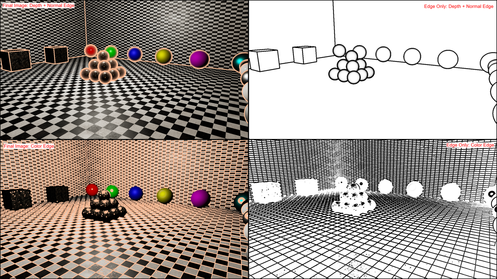

# Edge Detection and Screen Space Outlines

**Code Name:** EdgeDetectionOutline

## Description

In this example, screen-space outlines have been implemented with Sobel edge detection on the G-buffer (linear depth and geometric normals) or on the color (luminance).

## Output

## Controls

| Input   | Action                                                       |
|---------|--------------------------------------------------------------|
| W/A/S/D | Move the camera                                              |
| Mouse   | Look around with the camera                                  |
| Esc     | Close the window                                             |
| Space   | Turn on/off outlines                                         |
| B       | Switch debug view (final image / edges only)                 |
| N       | Switch edge source (depth + normal / depth / normal / color) |
| Q       | Increase exposure value                                      |
| E       | Decrease exposure value                                      |
| R       | Increase outline thickness                                   |
| F       | Decrease outline thickness                                   |

## Application Parameters

### Settings

| Parameter / Key                | Type              | Usage in Code                   | Description                         | Default Value |
|--------------------------------|-------------------|---------------------------------|-------------------------------------|---------------|
| AppSettings.ClearColor         | VkClearColorValue | AppSettings::ClearColor         | Background color of the screen      |               |
| AppSettings.MouseSensitivity   | float             | AppSettings::MouseSensitivity   | Mouse sensitivity value             |               |
| AppSettings.CameraSpeed        | float             | AppSettings::CameraSpeed        | Speed of the camera                 |               |

## Learning Objectives

- Understanding how the Sobel operator finds the edges with the gradient of an image
- Detecting silhouettes with linear depth and creases with normals from the G-Buffer
- Using relative depth differences and a grazing angle correction to avoid false edges

## Shader Status

| Shader Type | Status             | Notes                |
|-------------|--------------------|----------------------|
| GLSL        | :white_check_mark: |                      |
| HLSL        | :x:                | Will be implemented. |
| Slang       | :x:                | Will be implemented. |

## Theoretical Background

None

## Extensions Used

### Instance

Window system-dependent extensions:
- VK_KHR_surface
- VK_KHR_win32_surface (Windows)

### Device

- VK_KHR_swapchain
