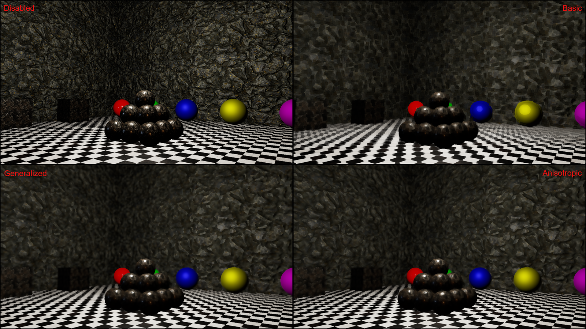

# Kuwahara Filter (Basic, Generalized, Anisotropic)

**Code Name:** KuwaharaFilter

## Description

In this example, the Kuwahara filter has been implemented in 3 variants (basic, generalized with smoothly weighted sectors, anisotropic with the local orientation from the structure tensor) for a painterly look.

## Output

## Controls

| Input   | Action                                                       |
|---------|--------------------------------------------------------------|
| W/A/S/D | Move the camera                                              |
| Mouse   | Look around with the camera                                  |
| Esc     | Close the window                                             |
| Space   | Switch filter (disabled / basic / generalized / anisotropic) |
| Q       | Increase exposure value                                      |
| E       | Decrease exposure value                                      |
| R       | Increase kernel radius (2 - 10)                              |
| F       | Decrease kernel radius (2 - 10)                              |

## Application Parameters

### Settings

| Parameter / Key                | Type              | Usage in Code                   | Description                         | Default Value |
|--------------------------------|-------------------|---------------------------------|-------------------------------------|---------------|
| AppSettings.ClearColor         | VkClearColorValue | AppSettings::ClearColor         | Background color of the screen      |               |
| AppSettings.MouseSensitivity   | float             | AppSettings::MouseSensitivity   | Mouse sensitivity value             |               |
| AppSettings.CameraSpeed        | float             | AppSettings::CameraSpeed        | Speed of the camera                 |               |

## Learning Objectives

- Understanding the Kuwahara filter as an edge-preserving smoothing filter
- Removing the blocky artifacts of the basic filter with smoothly weighted sectors (polynomial weights)
- Finding the local orientation and anisotropy with the structure tensor

## Shader Status

| Shader Type | Status             | Notes                |
|-------------|--------------------|----------------------|
| GLSL        | :white_check_mark: |                      |
| HLSL        | :x:                | Will be implemented. |
| Slang       | :x:                | Will be implemented. |

## Theoretical Background

None

## Extensions Used

### Instance

Window system-dependent extensions:
- VK_KHR_surface
- VK_KHR_win32_surface (Windows)

### Device

- VK_KHR_swapchain
