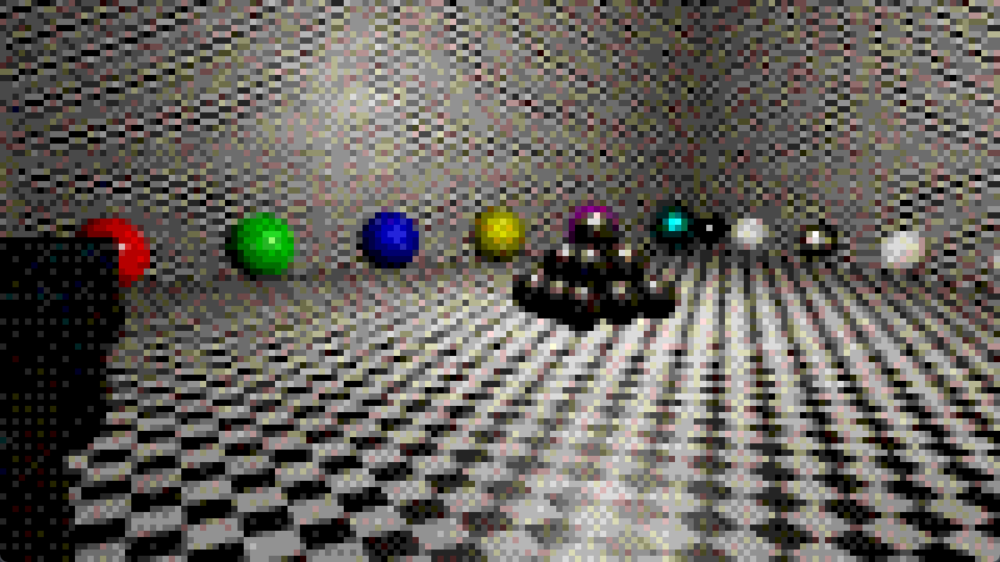

# Pixelation, Posterization and Ordered Dithering

**Code Name:** PixelationDithering

## Description

In this example, a camera motion blur effect has been implemented with depth reprojection. View-space position o each pixel is reprojected into the previous frame and the HDR color is averaged along the resulting screen-space velocity.

## Output

## Controls

| Input   | Action                                     |
|---------|--------------------------------------------|
| W/A/S/D | Move the camera                            |
| Mouse   | Look around with the camera                |
| Esc     | Close the window                           |
| Space   | Turn on/off motion the effect              |
| B       | Turn on/off ordered dithering              |
| Q       | Increase exposure value                    |
| E       | Decrease exposure value                    |
| R       | Increase pixel size (1 - 16)               |
| F       | Decrease pixel size (1 - 16)               |
| T       | Increase color levels per channel (2 - 32) |
| G       | Decrease color levels per channel (2 - 32) |

## Application Parameters

### Settings

| Parameter / Key                | Type              | Usage in Code                   | Description                         | Default Value |
|--------------------------------|-------------------|---------------------------------|-------------------------------------|---------------|
| AppSettings.ClearColor         | VkClearColorValue | AppSettings::ClearColor         | Background color of the screen      |               |
| AppSettings.MouseSensitivity   | float             | AppSettings::MouseSensitivity   | Mouse sensitivity value             |               |
| AppSettings.CameraSpeed        | float             | AppSettings::CameraSpeed        | Speed of the camera                 |               |

## Learning Objectives

- Implementing pixelation y averaging the colors of screen-space blocks
- Understanding why the quantization (posterization) is done after tone mapping and in the display (sRGB) space
- Constructing a Bayer 8x8 matrix with bit operations and using it for ordered dithering
- Hiding the banding of the posterization with ordered dithering

## Shader Status

| Shader Type | Status             | Notes                |
|-------------|--------------------|----------------------|
| GLSL        | :white_check_mark: |                      |
| HLSL        | :x:                | Will be implemented. |
| Slang       | :x:                | Will be implemented. |

## Theoretical Background

None

## Extensions Used

### Instance

Window system-dependent extensions:
- VK_KHR_surface
- VK_KHR_win32_surface (Windows)

### Device

- VK_KHR_swapchain
